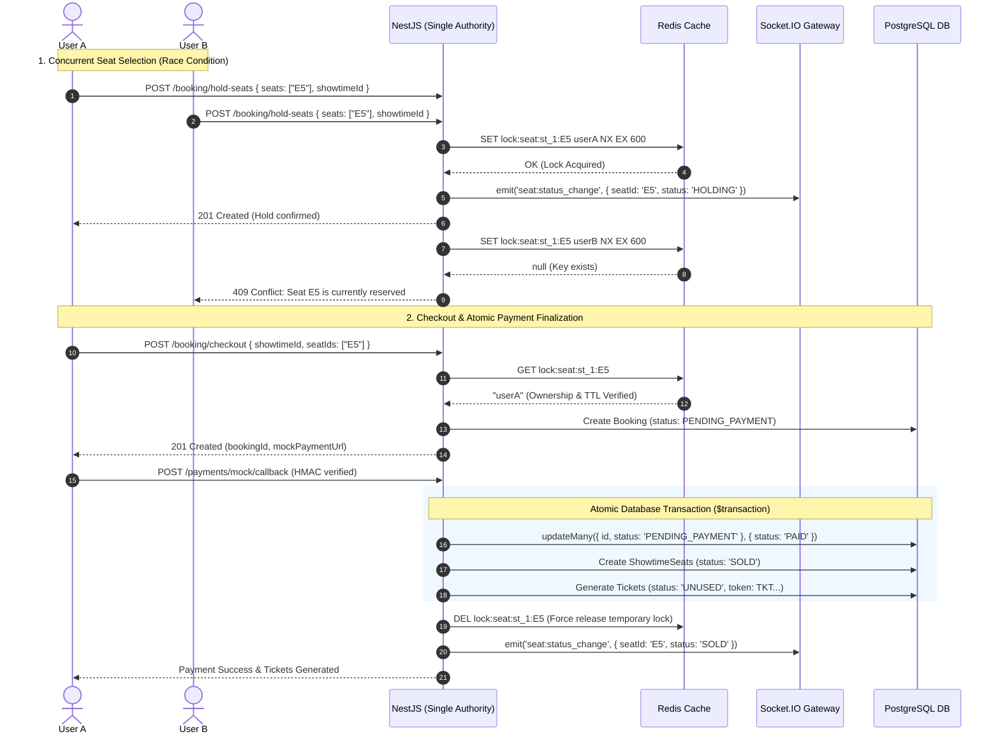

# PROJECT-DETAIL.md — TrueTix Movie Ticketing Platform Comprehensive Specification

---

## 1. Executive Summary

**TrueTix** is a high-concurrency, interview-focused real-time movie ticket reservation and cinema management system. The platform is engineered to demonstrate senior-level software engineering concepts with a focus on reliability, data consistency, and architectural defensibility:

1. **Double-Booking Prevention**: Solves flash-sale race conditions using a **Two-Tier Locking Strategy**:
   - **Tier 1 (Ephemeral Locks)**: High-throughput, distributed temporary locks in **Redis** (`SET lock:seat:{showtimeId}:{seatId} ownerToken NX EX 600`) with atomic Lua compare-and-delete release.
   - **Tier 2 (Permanent Source of Truth)**: **PostgreSQL** ACID transactions and unique constraints guaranteeing that seats are permanently marked `SOLD` only upon validated, idempotent payment completion.
2. **Single Seat-Reservation Authority**: NestJS backend serves as the single source of truth for seat holding, releasing, and checkout verification. Client frontend holds zero in-memory locking state and synchronizes live seat transitions in real time via Socket.IO.
3. **Multi-Seat Atomic Rollback**: All-or-nothing seat selection. If any seat in a requested batch fails to lock, all previously acquired locks in that batch are instantly released via Lua scripts, leaving no dangling locks.
4. **Idempotent Payment Sandbox**: Built-in mock payment gateway with HMAC-SHA256 signature verification, amount validation, and atomic conditional database transitions (`updateMany({ where: { id, status: 'PENDING_PAYMENT' } })`) that cleanly prevent duplicate charges or ticket issuances on network retries.
5. **Tamper-Proof Turnstile Verification**: QR ticket verification using standardized `TKT.<payload>.<sig>` tokens with `crypto.timingSafeEqual` to prevent side-channel timing attacks and atomic conditional status updates (`UNUSED` -> `CHECKED_IN`) to prevent gate double-admission.
6. **Modern Clean Architecture**: Frontend built on **Next.js 16 (App Router)**, React 19, Tailwind CSS, and Zustand; Backend built on **NestJS 10**, TypeScript, Prisma 5, PostgreSQL 15, and Redis 7.

---

## 2. Functional Requirements Matrix

### 2.1 Customer Facing Experience (Next.js 16 App Router)
* **Movie Discovery & Showtimes**:
  * Browse currently showing and upcoming movies.
  * Select cinema, hall, and showtime schedules.
* **Interactive Dynamic Seat Picker**:
  * Real-time rendering of room seating layouts (Rows A–H, Columns 1–10).
  * Color-coded status markers:
    - `AVAILABLE`: White/unreserved, selectable.
    - `SELECTED`: Cyan/highlighted by current user.
    - `HOLDING`: Amber with lock icon, temporarily held by another customer.
    - `SOLD`: Dark gray, permanently purchased in PostgreSQL.
  * Seat types: Standard, VIP, Couple.
  * Real-time WebSocket synchronization across all connected clients via Socket.IO.
* **Transient 10-Minute Lock Timer**:
  * Upon selecting seats, temporary 10-minute locks (`TTL = 600s`) are acquired in Redis.
  * Live countdown timer displayed in the UI checkout header.
  * Automatic lock expiry releases seats back to `AVAILABLE` status if payment is abandoned.
* **F&B Add-ons & Combos**:
  * Select popcorn and soda combo packages to accompany ticket orders.
  * Real-time order summary calculation.
* **Mock Payment Gateway & QR Ticket Generation**:
  * User is routed to the Mock Payment Sandbox (`/payment/mock-gateway`).
  * Simulates gateway success, simulated failure, and signature-verified webhook callbacks.
  * Generates digital HMAC-SHA256 QR tickets upon successful payment.
* **User Dashboard & Tickets**:
  * Real-time ticket viewer (`/user/tickets`) with dynamic QR code rendering.
  * Comprehensive booking history and payment receipts.

### 2.2 Admin & Cinema Operations (Backoffice)
* **Showtime & Seating Overview**:
  * View real-time occupancy and seat allocations per showtime.
* **QR Ticket Turnstile Scanner (`/admin/tickets/scan`)**:
  * High-speed turnstile gate check-in scanner.
  * Validates HMAC token signature and booking payment status (`PAID`).
  * Executes atomic check-in (`UNUSED` -> `CHECKED_IN`), rejecting duplicate or expired tickets.
* **1-Click Test Credentials**:
  * Built-in login shortcuts for Alice (Customer A), Bob (Customer B), and Admin for instant multi-user concurrency testing.

---

## 3. Technical Architecture & Engineering Solutions

### 3.1 Concurrency & Distributed Locking Workflow



### 3.2 Atomic Lua Lock Release Script

To prevent the **unconditional DEL** bug (where an expired or slow user accidentally deletes a newly acquired lock owned by someone else), lock release runs atomically inside Redis via Lua:

```lua
if redis.call("get", KEYS[1]) == ARGV[1] then
    return redis.call("del", KEYS[1])
else
    return 0
end
```

### 3.3 HMAC-SHA256 Digital Ticket Token Format

To ensure tamper-proof, offline-verifiable tickets:
* **Token Structure**: `TKT.<Base64UrlPayload>.<HMAC-Signature>`
* **Payload**:
  ```json
  {
    "ticketId": "tkt_89f3a12b",
    "bookingId": "bk_98a72c1",
    "showtimeId": "st_demo_1",
    "seatId": "E5",
    "iat": 1754438400,
    "exp": 1754449200
  }
  ```
* **Verification Algorithm**:
  1. Token is split into payload and signature.
  2. HMAC-SHA256 signature is recomputed with server `TICKET_HMAC_SECRET`.
  3. Signatures are compared using constant-time `crypto.timingSafeEqual` to eliminate timing attacks.
  4. Database verifies ticket's parent booking is `PAID`.
  5. Ticket is updated from `UNUSED` to `CHECKED_IN` conditionally:
     ```typescript
     const result = await tx.ticket.updateMany({
       where: { id: ticket.id, status: 'UNUSED' },
       data: { status: 'CHECKED_IN', checkedInAt: new Date() },
     });
     if (result.count === 0) throw new ConflictException('Ticket already used');
     ```

---

## 4. Environment & Stack Specifications

| Layer | Technology | Details |
|---|---|---|
| **Backend** | NestJS 10, TypeScript | Modular architecture (`Auth`, `Booking`, `Payment`, `Ticket`, `Redis`, `WebSocket`) |
| **Frontend** | Next.js 16 (App Router), React 19 | Tailwind CSS, Lucide Icons, Zustand, Socket.IO Client |
| **Database** | PostgreSQL 15 | Managed with Prisma 5 ORM |
| **Cache & Locks** | Redis 7 | Managed with `ioredis` |
| **Real-time** | Socket.IO | Verified JWT handshake authentication |
| **Testing** | Vitest | 19 automated tests covering all 15 interview scenarios + concurrency test |

---

## 5. Automated Test Suite Matrix

The backend includes 19 automated tests validating every critical engineering scenario:

| File | Scenario / Feature | Expected Outcome |
|---|---|---|
| `booking.service.spec.ts` | Single seat lock | Returns success when seat is available |
| `booking.service.spec.ts` | Double-booking attempt | Rejects second user with 409 Conflict |
| `booking.service.spec.ts` | Lock owner release | Successfully releases lock via Lua script |
| `booking.service.spec.ts` | Unauthorized release | Non-owner cannot release another user's lock |
| `booking.service.spec.ts` | Multi-seat rollback | Atomic rollback if any seat in batch fails |
| `booking.service.spec.ts` | Expired checkout | Rejects checkout if hold TTL has expired |
| `booking.service.spec.ts` | Expired seat re-locking | Re-allows reservation once TTL expires |
| `booking.service.spec.ts` | Booking IDOR protection | Prevents viewing or checking out another user's booking |
| `payment.service.spec.ts` | Payment finalization | Marks booking `PAID`, seats `SOLD`, generates tickets |
| `payment.service.spec.ts` | Webhook idempotency | Duplicate callbacks update 0 rows and return cached status |
| `payment.service.spec.ts` | Amount validation | Rejects mismatched payment amounts |
| `ticket.service.spec.ts` | Signature verification | Rejects forged or altered QR signatures |
| `ticket.service.spec.ts` | Unpaid ticket scan | Rejects tickets whose parent booking is not `PAID` |
| `ticket.service.spec.ts` | Duplicate check-in | Rejects scanning an already `CHECKED_IN` ticket |
| `ticket.service.spec.ts` | Gate race conditions | Atomic `updateMany` admits exactly one scan |
| `websocket.gateway.spec.ts` | Socket authentication | Rejects unauthenticated connections; derives user ID from JWT claims |
| `booking.concurrency.spec.ts` | Real simultaneous race | `Promise.all` concurrency test: exactly 1 winner, 1 rejected |
