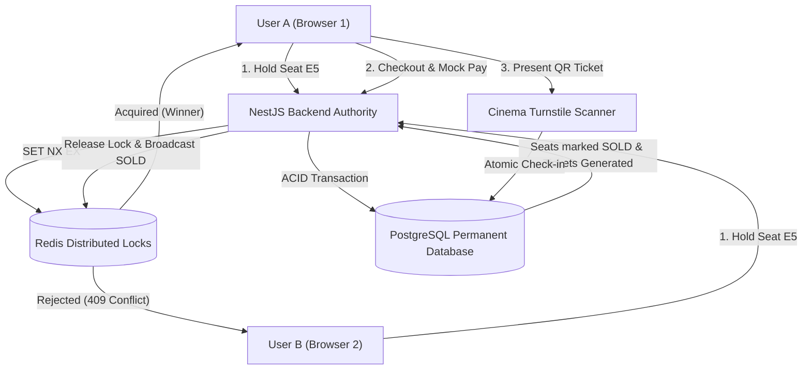

# TrueTix — Real-Time Movie Ticket Platform

> **A high-concurrency, interview-focused movie ticketing platform engineered to prevent double-booking using a two-tier locking architecture (Redis Distributed Locks + PostgreSQL ACID Transactions).**

[](https://nodejs.org)
[](https://nestjs.com)
[](https://nextjs.org)
[](https://prisma.io)
[](https://postgresql.org)
[](https://redis.io)
[](https://vitest.dev)

---

## 🎯 Core Technical Highlight

**Preventing race conditions and double booking in a real-time ticket reservation system.**

When thousands of users select seats for a blockbuster film simultaneously, naive database queries fail due to race conditions between `SELECT` and `INSERT/UPDATE`. TrueTix addresses this with a **Two-Tier Locking Strategy**:
1. **Tier 1 (Ephemeral Locks)**: Sub-millisecond distributed locks in **Redis** (`SET lock:seat:... ownerToken NX EX 600`) hold seats for 10 minutes with zero database disk I/O.
2. **Tier 2 (Permanent Source of Truth)**: **PostgreSQL** transactions and composite unique constraints (`@@unique([showtimeId, seatId])`) ensure that seats are permanently marked `SOLD` only upon validated, idempotent payment completion.



---

## 🏗️ System Architecture & Engineering Principles

- **Single Seat-Reservation Authority**: NestJS + Redis acts as the sole authority. The frontend contains zero in-memory locking logic and synchronizes live state through Socket.IO.
- **Atomic Lua Lock Release**: Never deletes locks with raw `DEL`. Releasing locks uses an atomic Lua script that compares the stored lock owner with the requester's token before deleting.
- **Multi-Seat Atomic Rollback**: If a customer requests seats `[A1, A2, A3]` and `A3` fails to lock, `A1` and `A2` are immediately rolled back via Lua. No partial seat reservations remain.
- **Payment Idempotency**: Payment callbacks are validated with HMAC signatures and execute atomic conditional updates (`updateMany({ where: { id, status: 'PENDING_PAYMENT' } })`). Repeated or concurrent webhooks update 0 rows on subsequent attempts, preventing duplicate financial transactions or tickets.
- **Timing-Safe HMAC-SHA256 Digital Tickets**: QR tickets use the standardized format `TKT.<payload>.<signature>` and are verified with `crypto.timingSafeEqual` to prevent side-channel timing attacks.
- **Atomic Turnstile Check-In**: Cinema gates verify booking payment status (`PAID`) and check in tickets using atomic conditional updates (`where: { id, status: 'UNUSED' }, data: { status: 'CHECKED_IN' }`), guaranteeing that two scanners scanning the same ticket simultaneously cannot both admit the customer.
- **Authenticated WebSockets**: Socket.IO connections require verified JWT tokens; user identities are derived directly from verified JWT claims rather than client-supplied payloads.

---

## 📚 Technical Interview Documentation Suite

Comprehensive engineering guides have been created in the [`docs/`](./docs) directory:

| Document | Description |
|---|---|
| 📐 [**Architecture Guide**](./docs/ARCHITECTURE.md) | Full architectural breakdown, layer responsibilities, and system Mermaid diagrams. |
| 🔄 [**Booking Flow Lifecycle**](./docs/BOOKING_FLOW.md) | End-to-end API sequence diagram, lock lifecycles, and database transaction transitions. |
| 🗄️ [**Database Schema & Constraints**](./docs/DATABASE.md) | Complete Entity-Relationship Diagram (ERD), table structures, and consistency rules. |
| 💡 [**SDE Interview Defense Guide**](./docs/INTERVIEW_GUIDE.md) | Beginner-friendly answers to 11 core interview questions (race conditions, `SET NX EX`, Lua, ACID, idempotency). |
| ⚖️ [**Engineering Decisions & Trade-offs**](./docs/DECISIONS.md) | Justifications for design decisions and trade-offs. |
| 🔍 [**Known Limitations & Production Roadmap**](./docs/KNOWN_LIMITATIONS.md) | Honest assessment of current architectural boundaries and recommended production enhancements. |

---

## 🧪 Automated Test Suite (19 Passed)

TrueTix includes automated unit, integration, and concurrency tests covering all 15 core scenarios:

```bash
cd backend
npm test
```

### Verified Test Results:
```text
✓ src/modules/booking/booking.service.spec.ts (8 tests)
  ✓ Scenario 1: User A successfully holds an available seat
  ✓ Scenario 2: User B cannot hold the same seat when already held
  ✓ Scenario 3: The lock owner can release the seat
  ✓ Scenario 4: Another user cannot release that lock (Lua owner check)
  ✓ Scenario 5: A failed multi-seat reservation rolls back earlier locks
  ✓ Scenario 6: An expired reservation cannot be checked out
  ✓ Scenario 7: An expired seat holder is null and can be re-locked
  ✓ Scenario 15: A user cannot access another user's booking

✓ src/modules/ticket/ticket.service.spec.ts (4 tests)
  ✓ Scenario 10: Invalid QR signatures are rejected with UnprocessableEntityException
  ✓ Scenario 11: Valid QR tickets for unpaid bookings are rejected
  ✓ Scenario 12: A ticket cannot be checked in twice
  ✓ Scenario 13: Simultaneous check-in requests cannot both succeed (Atomic DB update)

✓ src/modules/payment/payment.service.spec.ts (3 tests)
  ✓ Scenario 8: A successful payment marks the booking paid and seats as SOLD
  ✓ Scenario 9: Repeated payment callbacks do not create duplicates (Idempotency)
  ✓ Rejects payment callback when amount does not match expected booking total

✓ src/modules/websocket/websocket.gateway.spec.ts (3 tests)
  ✓ Scenario 14: Unauthenticated WebSocket connection without token is immediately rejected
  ✓ Rejects connection when token verification fails
  ✓ Successfully authenticates connection and stores user identity from verified JWT

✓ src/modules/booking/booking.concurrency.spec.ts (1 test)
  ✓ Two users attempt to reserve the exact same seat simultaneously: Exactly one succeeds

Test Files  5 passed (5)
     Tests  19 passed (19)
```

---

## 🚀 Quick Start & Local Setup

### 1. Start Infrastructure (PostgreSQL & Redis via Docker)
```bash
docker compose up -d db redis
```

### 2. Setup Backend & Seed Development Data
```bash
cd backend
npm install
npm run db:push
npm run db:seed
npm run start:dev
```
- **Backend API**: `http://localhost:4000/api/v1`
- **Swagger Interactive API Docs**: `http://localhost:4000/api/docs`

### 3. Setup Frontend
```bash
cd ../frontend
npm install
npm run dev
```
- **Web App**: `http://localhost:3000`

---

## 👥 Demo Accounts & Concurrency Walkthrough

Development seed data initializes the following test accounts (`Password123!`):

| Role | Name | Email | Password |
|---|---|---|---|
| **Customer A** | Alice Johnson | `alice@truetix.com` | `Password123!` |
| **Customer B** | Bob Smith | `bob@truetix.com` | `Password123!` |
| **Admin / Staff** | System Admin | `admin@truetix.com` | `Password123!` |

### 🎬 Two-Browser Concurrency Demonstration:
1. Open [http://localhost:3000/login](http://localhost:3000/login) in Window 1 and click **Alice (Customer A)** to log in with 1-click.
2. Open an **Incognito** window at [http://localhost:3000/login](http://localhost:3000/login) and click **Bob (Customer B)** to log in.
3. Both navigate to [http://localhost:3000/booking/seats?showtimeId=st_demo_1](http://localhost:3000/booking/seats?showtimeId=st_demo_1).
4. Alice selects seat **E5** and clicks **Continue to Combos**:
   - Seat **E5** turns amber with a lock icon in Bob's window in real time via Socket.IO.
   - If Bob clicks or sends a request for **E5**, the backend rejects it with `409 Conflict: Seat E5 is currently reserved`.
5. Alice proceeds to checkout and clicks **Simulate Success** on the Mock Payment Sandbox:
   - Seat **E5** transitions permanently to dark gray (**SOLD**) across all connected screens.
   - An HMAC-SHA256 digital QR ticket is generated.
6. Navigate to the Turnstile Scanner at [http://localhost:3000/admin/tickets/scan](http://localhost:3000/admin/tickets/scan):
   - Scan or paste Alice's ticket token: **ADMISSION GRANTED**.
   - Attempt to scan the same ticket again: **ACCESS DENIED: Ticket already used**.

---

## 🌿 Git Branches

- **`main`**: The current high-reliability, interview-focused implementation.
- **`backup-original`**: Frozen copy of the original codebase before these improvements.

---

## 📄 License
This project is licensed under the MIT License.
