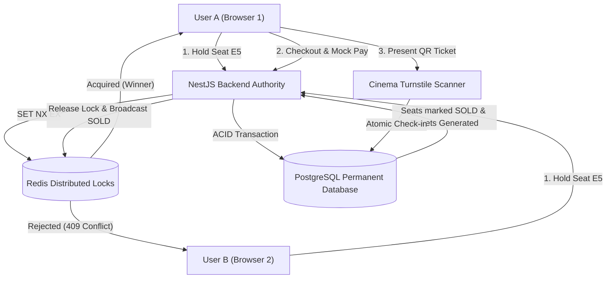

# TrueTix

> A real-time movie ticketing and reservation platform engineered with Next.js, NestJS, Redis, and PostgreSQL. Built with a two-tier distributed locking architecture to prevent double-booking and race conditions during high-demand ticket sales.

[](https://nodejs.org)
[](https://nestjs.com)
[](https://nextjs.org)
[](https://prisma.io)
[](https://postgresql.org)
[](https://redis.io)
[](https://vitest.dev)
[](https://opensource.org/licenses/MIT)

---

## Overview

When thousands of users select seats for high-demand movie releases simultaneously, standard database queries fail due to race conditions between `SELECT` and `INSERT/UPDATE`. 

TrueTix addresses this with a **Two-Tier Locking Strategy**:
1. **Tier 1 (Ephemeral Holds)**: Sub-millisecond distributed locks in **Redis** (`SET lock:seat:... ownerToken NX EX 600`) hold seats for 10 minutes with zero database disk I/O.
2. **Tier 2 (Permanent Source of Truth)**: **PostgreSQL** ACID transactions and composite unique constraints (`@@unique([showtimeId, seatId])`) guarantee that seats are permanently marked `SOLD` only upon validated, idempotent payment completion.



---

## Features

- **Live Seat Map Synchronization**: Real-time interactive seat grid updated across all connected clients via Socket.IO.
- **Single Seat-Reservation Authority**: NestJS backend manages all lock state. Client UI holds zero in-memory locking state and reflects authoritative backend updates.
- **Atomic Lua Lock Release**: Locks are released using a compare-and-delete Lua script that compares the stored lock owner before deleting, preventing expired clients from releasing newly acquired locks.
- **Multi-Seat Atomic Rollback**: All-or-nothing seat selection. If any seat in a requested batch fails to lock, all previously acquired locks in that batch are instantly rolled back.
- **Idempotent Payment Sandbox**: Mock payment gateway with HMAC signature verification and atomic conditional database updates (`updateMany({ where: { id, status: 'PENDING_PAYMENT' } })`) to prevent duplicate transactions on network retries.
- **Tamper-Proof Digital Tickets**: QR tickets use standardized `TKT.<payload>.<sig>` tokens verified with `crypto.timingSafeEqual` to eliminate timing attacks.
- **Atomic Turnstile Scanner**: High-speed scanner gate endpoint for theater staff that validates tickets and checks them in atomically (`UNUSED` -> `CHECKED_IN`).
- **Authenticated WebSockets**: Handshake authentication requiring valid JWT tokens, with user identity extracted directly from verified token claims.

---

## Architecture & Documentation

Comprehensive system design documents are available in the [`docs/`](./docs) directory:

| Document | Description |
|---|---|
| 📐 [**Architecture Guide**](./docs/ARCHITECTURE.md) | System components, module boundaries, and layer responsibilities. |
| 🔄 [**Booking Flow Lifecycle**](./docs/BOOKING_FLOW.md) | End-to-end API sequence diagram, lock lifecycles, and transaction states. |
| 🗄️ [**Database Schema & Constraints**](./docs/DATABASE.md) | Entity-Relationship Diagram (ERD), table definitions, and data integrity rules. |
| 🔍 [**Concurrency Deep Dive & FAQ**](./docs/CONCURRENCY_FAQ.md) | Detailed breakdown of distributed locking, Lua scripts, ACID transactions, and idempotency. |
| ⚖️ [**Engineering Decisions & Trade-offs**](./docs/DECISIONS.md) | Technical rationale and trade-offs behind stack and architecture choices. |
| 📋 [**Known Limitations & Roadmap**](./docs/KNOWN_LIMITATIONS.md) | Current architectural boundaries and future production enhancements. |

---

## Tech Stack

| Layer | Technologies |
|---|---|
| **Frontend** | Next.js 16 (App Router), React 19, Tailwind CSS, Zustand, Socket.IO Client |
| **Backend** | NestJS 10, TypeScript, Prisma ORM, Socket.IO, Passport JWT, bcrypt |
| **Database** | PostgreSQL 15 |
| **Caching & Locking** | Redis 7 (`ioredis`) |
| **Testing** | Vitest |

---

## Getting Started

### Prerequisites
- Node.js 20+
- Docker & Docker Compose (or local PostgreSQL 15 and Redis 7 instances)

### 1. Start Infrastructure (PostgreSQL & Redis)
```bash
docker compose up -d db redis
```

### 2. Backend Setup
```bash
cd backend
npm install
npm run db:push
npm run db:seed
npm run start:dev
```
- **Backend API**: `http://localhost:4000/api/v1`
- **Swagger Interactive API Docs**: `http://localhost:4000/api/docs`

### 3. Frontend Setup
```bash
cd ../frontend
npm install
npm run dev
```
- **Web App**: `http://localhost:3000`

---

## Demo Accounts & Concurrency Testing

The database seeder pre-configures test accounts (`Password123!`):

| Role | Name | Email | Password |
|---|---|---|---|
| **Customer A** | Alice Johnson | `alice@truetix.com` | `Password123!` |
| **Customer B** | Bob Smith | `bob@truetix.com` | `Password123!` |
| **Admin / Staff** | System Admin | `admin@truetix.com` | `Password123!` |

### Testing Real-Time Concurrency (2 Browsers):
1. Open [http://localhost:3000/login](http://localhost:3000/login) in Window 1 and click **Alice** to log in.
2. Open an **Incognito** window at [http://localhost:3000/login](http://localhost:3000/login) and click **Bob** to log in.
3. Both navigate to the demo showtime: [http://localhost:3000/booking/seats?showtimeId=st_demo_1](http://localhost:3000/booking/seats?showtimeId=st_demo_1).
4. Alice selects seat **E5**:
   - Seat **E5** turns amber with a lock icon in Bob's window in real time via Socket.IO.
   - If Bob clicks or requests **E5**, the backend rejects it with `409 Conflict: Seat E5 is currently reserved`.
5. Alice proceeds to checkout and completes payment on the Mock Payment Sandbox:
   - Seat **E5** transitions permanently to dark gray (**SOLD**) across all connected screens.
   - A digital QR ticket is generated.
6. Open the Turnstile Scanner at [http://localhost:3000/admin/tickets/scan](http://localhost:3000/admin/tickets/scan):
   - Scan Alice's ticket token: **ADMISSION GRANTED**.
   - Attempt to scan the same ticket again: **ACCESS DENIED: Ticket already used**.

---

## Testing

The backend includes a comprehensive automated test suite covering distributed locking, rollback, idempotency, QR verification, and concurrent race conditions:

```bash
cd backend
npm test
```

### Test Coverage Highlights:
- **Distributed Locking**: Single-seat lock acquisition, conflict rejection on occupied seats, and lock expiry.
- **Atomic Lua Release**: Verifies lock owners can release seats and non-owners cannot release another user's hold.
- **Multi-Seat Rollback**: Verifies that a failure to lock any seat in a batch atomically releases all earlier seats.
- **Payment Idempotency**: Repeated or concurrent webhook callbacks update 0 rows and return idempotent success.
- **Turnstile Security**: Signature validation, payment status verification, and atomic duplicate check-in prevention.
- **Simultaneous Race Conditions**: `Promise.all` concurrency test confirming that when two users reserve the exact same seat simultaneously, exactly one succeeds and one is rejected.

---

## License

This project is licensed under the MIT License.
