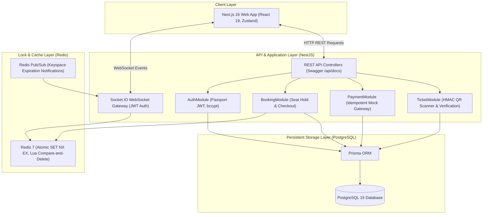

# TrueTix System Architecture

## 1. System Overview

TrueTix is a real-time movie ticketing system engineered to prevent race conditions and double-booking in high-concurrency environments.

---

## 2. Frontend & Backend Responsibilities

### Frontend (Next.js 16 + React 19)
- **Role**: Presentation and client-side interaction only.
- **State Management**: Zustand stores (`useAuthStore`, `useBookingStore`) handle authentication tokens and temporary booking selections in browser memory.
- **Seat Availability**: The frontend **never** acts as an authority for locking. It fetches authoritative seat statuses from NestJS (`/showtimes/:id/seats`) and listens to Socket.IO events for live state changes.
- **Communication**: Communicates with the backend using Axios (HTTP) and Socket.IO Client (WebSockets) passing JWT Bearer tokens in headers and connection handshakes.

### Backend (NestJS 10)
- **Role**: Single source of truth for business rules, validation, seat availability, locking, transactions, and ticket security.
- **Modules**:
  - `AuthModule`: Issues JWT access and refresh tokens; verifies passwords using `bcrypt`.
  - `BookingModule`: Manages seat holds, rollbacks, and checkout using Redis locks and PostgreSQL database transactions.
  - `PaymentModule`: Provides an idempotent mock payment sandbox with simulated HMAC signatures and atomic status transitions.
  - `TicketModule`: Issues and verifies HMAC-SHA256 signed digital QR tokens and turnstile check-ins.
  - `WebsocketGateway`: Authenticates WebSocket connections and broadcasts real-time seat lock state changes to clients viewing a specific showtime room.
  - `RedisModule`: Encapsulates atomic Redis distributed locking (`SET NX EX`) and atomic Lua release scripts.
  - `PrismaModule`: Connects to PostgreSQL and executes ACID transactions (`$transaction`).

---

## 3. Technology Rationale & Trade-offs

| Component | Technology | Why Chosen? | Interview Defense |
|---|---|---|---|
| **Frontend** | Next.js 16 (App Router) | Server-Side Rendering for SEO-sensitive movie pages, fast hydration, and modern React 19 component model. | Clear separation of presentation from backend logic. |
| **Backend** | NestJS | Modular, enterprise-grade architecture with TypeScript, built-in dependency injection, and declarative guards/pipes. | Highly testable, structured, and easy to maintain. |
| **Temporary Locks** | Redis (ioredis) | Sub-millisecond in-memory atomic operations (`SET NX EX`) with automatic TTL expiration. | Prevents overwhelming the database during high-traffic flash sales. |
| **Permanent Store** | PostgreSQL 15 | Relational ACID database with strong consistency, row-level locks, and relational foreign keys. | Guarantees that paid bookings and sold seats are never duplicated or lost. |
| **ORM** | Prisma | Type-safe database queries, schema-driven migrations, and atomic `$transaction` blocks. | Avoids raw SQL errors and provides compile-time safety. |
| **Real-Time** | Socket.IO | Bi-directional event broadcasting with room-based scoping (`showtime:id`). | Updates other users' seat maps immediately without client polling. |
