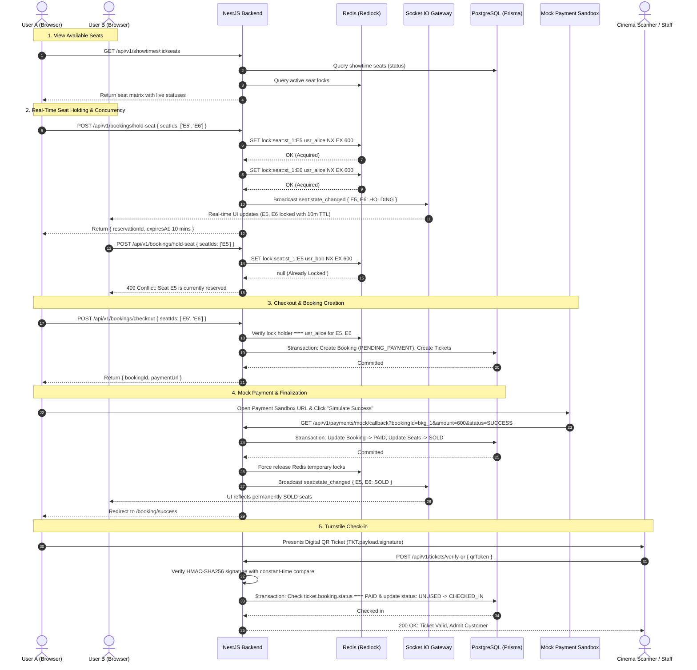

# TrueTix End-to-End Booking Flow

## 1. High-Level Booking Sequence



---

## 2. Redis Lock Lifecycle

1. **Acquisition (`acquireSeatLock`)**:
   - Executes atomic command: `SET lock:seat:{showtimeId}:{seatId} {userId} NX EX 600`.
   - `NX`: Only set the key if it does **not** already exist.
   - `EX 600`: Set a hard Time-To-Live (TTL) of 600 seconds (10 minutes).
2. **Multi-Seat Atomic Rollback**:
   - If User A selects seats `['A1', 'A2', 'A3']`:
   - If `A1` and `A2` succeed, but `A3` fails (held by someone else):
   - The backend immediately releases `A1` and `A2` using owner-checked Lua scripts and throws a `409 Conflict`.
   - **Guarantee**: No partial seat holds are ever left dangling.
3. **Atomic Lua Release (`releaseSeatLock`)**:
   - Uses an atomic Lua compare-and-delete script:
     ```lua
     if redis.call("get", KEYS[1]) == ARGV[1] then
       return redis.call("del", KEYS[1])
     else
       return 0
     end
     ```
   - Prevents User B from accidentally or maliciously releasing User A's seat reservation.
4. **Natural Expiration**:
   - If a customer abandons their cart, Redis automatically expires the key after 10 minutes.
   - Keyspace notifications (`__keyevent@0__:expired`) notify the WebSocket gateway to broadcast an `AVAILABLE` event to all connected clients.

---

## 3. Database Consistency & State Transitions

```
[Seat: AVAILABLE]
       │
       ▼ (User holds seat)
[Redis Lock: HOLDING (TTL 10m)]
       │
       ├───────────────────────────────────────────────┐
       ▼ (User checks out & completes payment)         ▼ (TTL expires or user cancels)
[Database: SOLD (Permanent)]                   [Seat: AVAILABLE]
```

- **PostgreSQL Source of Truth**: Redis is an ephemeral performance gatekeeper; PostgreSQL remains the ultimate permanent record for financial transactions, paid bookings, and sold seats.
- **Double-Booking Guarantee**: During checkout and payment, conditional updates ensure that a seat can never transition to `SOLD` more than once.
