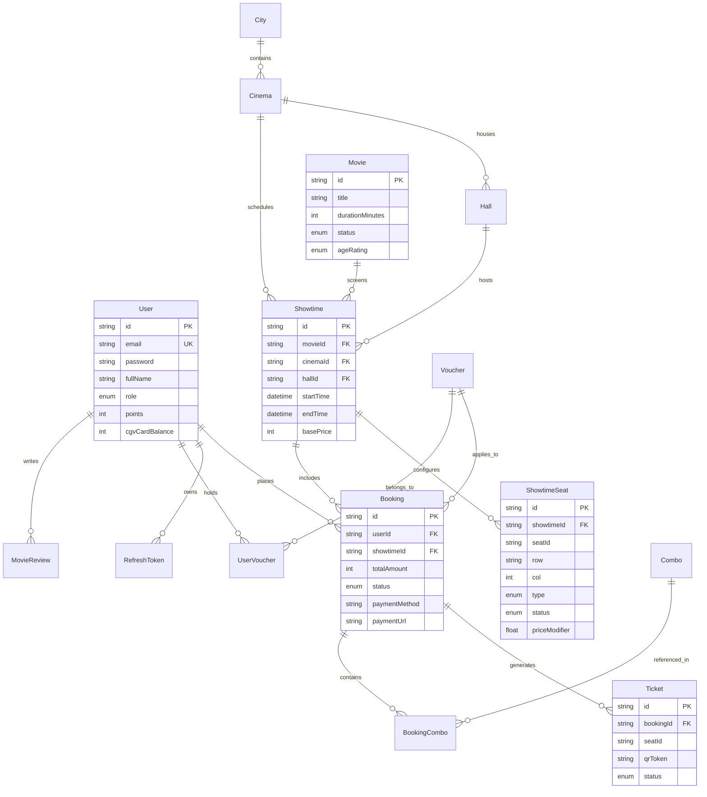

# TrueTix Database Design & Schema Reference

## 1. Entity-Relationship Diagram (ERD)

---

## 2. Important Tables & Schema Design

### `showtime_seats`
- Represents an individual seat instance for a specific showtime.
- **Composite Unique Index**: `@@unique([showtimeId, seatId])` ensures that for any given showtime, a seat identifier (e.g. `H12`) exists exactly once in the table.
- **Statuses**: `AVAILABLE`, `HOLDING`, `SOLD`, `BLOCKED`.

### `bookings`
- Records the customer order header.
- **Statuses**:
  - `PENDING_PAYMENT`: Initial order created; awaiting gateway confirmation.
  - `PAID`: Payment validated and finalized.
  - `CANCELLED`: Payment failed or cancelled by user.
  - `EXPIRED`: Payment time window expired.

### `tickets`
- Digital ticket record with encrypted/signed QR payload.
- **Statuses**:
  - `UNUSED`: Valid and ready for admission.
  - `CHECKED_IN`: Scanned and admitted at cinema turnstile.
  - `CANCELLED`: Booking was cancelled or refunded.

---

## 3. Database Constraints & Idempotency Rules

1. **Composite Uniqueness on Seats**:
   - `@@unique([showtimeId, seatId])` prevents inserting duplicate seats for a showtime.
2. **Atomic Status Update on Check-in**:
   - Updates `status` from `UNUSED` to `CHECKED_IN` conditionally using `updateMany({ where: { id, status: 'UNUSED' }, data: { status: 'CHECKED_IN' } })`.
   - If two scanner requests arrive concurrently, the first updates 1 row; the second matches 0 rows and is rejected.
3. **Atomic Payment Finalization**:
   - Updates `Booking` from `PENDING_PAYMENT` to `PAID` conditionally. Repeated callbacks or concurrent race conditions update 0 rows on subsequent attempts, guaranteeing financial idempotency.
